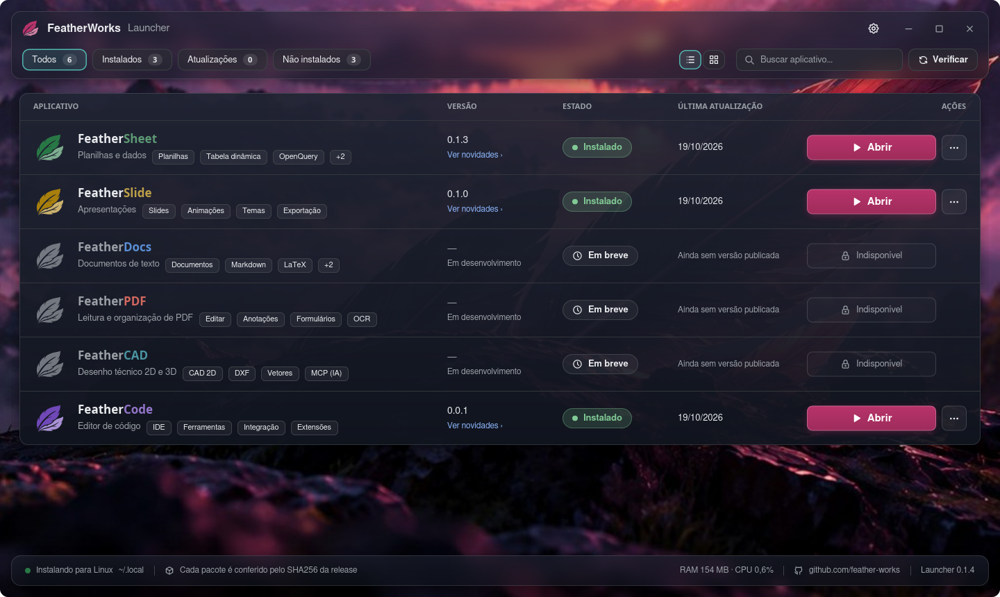

<p align="center">
  
</p>

<h1 align="center">FeatherWorks</h1>

<p align="center">
  Uma família de aplicativos de escritório leves, nativos e privados, feitos 100% em Rust com Iced.
</p>

## Comece pelo launcher

O **FeatherWorks Launcher** instala, atualiza e abre todos os aplicativos da suíte, e confere cada pacote pelo SHA256 antes de instalar.

<p align="center">
  <a href="https://github.com/feather-works/featherlauncher/releases/latest/download/featherlauncher-linux-amd64.deb"><b>⬇ Linux (.deb)</b></a>
  &nbsp;·&nbsp;
  <a href="https://github.com/feather-works/featherlauncher/releases/latest/download/featherlauncher-linux-x86_64.tar.gz"><b>⬇ Linux (.tar.gz)</b></a>
  &nbsp;·&nbsp;
  <a href="https://github.com/feather-works/featherlauncher/releases/latest/download/featherlauncher-windows-x64.exe"><b>⬇ Windows (.exe)</b></a>
</p>

<p align="center">
  <a href="https://github.com/feather-works/featherlauncher">
    
  </a>
</p>

No `.tar.gz`, descompacte e rode `./instalar.sh`; o `.exe` do Windows é portátil, é só abrir.

## Privacidade por padrão

Sem conta, sem login, sem telemetria. Tudo roda na sua máquina e nada do seu conteúdo sai dela.

## Os aplicativos

| | Aplicativo | Para quê | Estado | Instalar sozinho |
|---|---|---|---|---|
|  | [**FeatherSheet**](https://github.com/feather-works/feathersheet) | Planilhas: fórmulas em português e inglês, gráficos, tabelas dinâmicas, macros, abre e grava `.xlsx` | v0.1.3 | [Linux, Windows e macOS](https://github.com/feather-works/feathersheet/releases/latest) |
|  | [**FeatherSlide**](https://github.com/feather-works/featherslide) | Apresentações: abre `.pptx` e `.odp`, exporta PDF | v0.1.0 | [Linux e Windows](https://github.com/feather-works/featherslide/releases/latest) |
|  | [**FeatherDocs**](https://github.com/feather-works/featherdocs) | Textos: DOCX, LaTeX e Markdown | em desenvolvimento | — |
|  | **FeatherPDF** | Leitura e organização de PDF | em desenvolvimento | — |
|  | **FeatherCAD** | Desenho técnico 2D e 3D | em desenvolvimento | — |
|  | **FeatherCode** | Editor de código | em desenvolvimento | — |

Cada aplicativo é um produto independente, com repositório, versão e instalador próprios. Quem prefere instalar sem o launcher encontra os pacotes (`.deb`, `.tar.gz`, `.exe`) e o `SHA256SUMS` na página de releases de cada repositório.

## Os arquivos `f··z`

```
f   sh   z      → .fshz  (FeatherSheet)
f   do   z      → .fdoz  (FeatherDocs)
f   sd   z      → .fsdz  (FeatherSlide)
│   │    └── z: compactado (ZIP ou gzip)
│   └─────── o tipo do arquivo
└─────────── Feather
```

O conteúdo fica em **Apache Arrow**, um formato binário por colunas, sem JSON dentro.

### `.fsdz` (apresentação, ZIP)

```
apresentacao.fsdz
├── data/
│   ├── apresentacao.arrow   ← 1 linha: título, autor, proporção, versão do formato
│   ├── slides.arrow         ← 1 linha por slide: layout, fundo, notas, oculto, comentários
│   ├── elementos.arrow      ← 1 linha por elemento: slide, posição, cores, texto, estilo,
│   │                          link, tabela/gráfico (coluna "dados")
│   ├── personalizadas.arrow ← sequências de slides personalizadas
│   └── fontes.arrow         ← quais fontes estão embutidas
└── assets/
    ├── imagem-1.png         ← imagens como arquivo de verdade (não base64)
    └── fontes/
        └── Roboto-regular.ttf  ← fontes embutidas
```

### `.fdoz` (documento, ZIP)

```
documento.fdoz
├── data/
│   ├── documento.arrow      ← 1 linha: título, autor, papel, margens, cabeçalho, rodapé
│   ├── blocos.arrow         ← 1 linha por parágrafo, título, lista, tabela…
│   ├── trechos.arrow        ← o texto formatado (negrito, cor…), apontando o bloco
│   ├── tabelas.arrow        ← a forma de cada tabela (linhas, colunas, mesclas)
│   ├── estilos.arrow        ← estilos com nome (Título 1, Citação…)
│   ├── marcadores.arrow     ← indicadores e referências cruzadas
│   ├── comentarios.arrow    ← comentários da revisão
│   ├── respostas.arrow      ← respostas aos comentários
│   └── fontes.arrow         ← fontes embutidas
└── assets/
    └── imagem-1.png
```

### `.fshz` (planilha, binário FSH3)

Planilha pode ter milhões de linhas. Por isso esse formato é um fluxo binário único, sem vários arquivos dentro:

```
planilha.fshz
├── "FSH3"                         ← assinatura (4 bytes)
└── gzip ──────────────────────────────────────────────
    ├── tamanho dos metadados      ← u32
    ├── metadados (MessagePack)
    │   ├── versão, aba ativa, nomes definidos, estilos, tabela de textos
    │   └── uma entrada por aba:
    │       nome, cor da aba, oculta, larguras e alturas,
    │       gráficos, tabelas, tabelas dinâmicas, OpenQuery, validação,
    │       mesclas, imagens, formas, tinta, botões, comentários,
    │       formatação condicional, estilos por célula/linha/coluna,
    │       fórmulas (padrão por coluna), células avulsas
    └── blocos Apache Arrow IPC    ← os valores das células, coluna por coluna
```

### O que vem depois

O contrato do formato prevê um repositório **Git embutido** em cada arquivo, para guardar o histórico de versões sem servidor:

```
arquivo.f··z
├── manifest.json
├── .git/        ← ainda não implementado
├── data/
└── assets/
```

### Por que é melhor que `.xlsx`, `.docx` e `.pptx`

| | Office (`.xlsx` / `.docx` / `.pptx`) | Feather (`.f··z`) |
|---|---|---|
| Conteúdo | ZIP de XML: texto com marcação | Apache Arrow: binário por colunas |
| Números | viram texto e são convertidos de novo ao abrir | ficam como número, sem conversão |
| Velocidade | ler XML grande é lento | planilha de 2 milhões de linhas abre em cerca de 1 s (medido) |
| Imagens e fontes | arquivos dentro do ZIP | arquivos dentro do ZIP (no `.fshz`, dentro do binário) |
| Gravação | sem garantia se cair no meio | grava à parte e só então substitui (atômica) |
| Ler com outras ferramentas | precisa de biblioteca de Office | Arrow abre direto em pandas, Polars e DuckDB |
| Privacidade | metadados de conta e empresa | nada de conta nem telemetria |
| Compatibilidade | — | os apps continuam abrindo e salvando `.xlsx`, `.docx`, `.pptx` e `.pdf` |

## Bibliotecas compartilhadas

| Repositório | O que faz |
|---|---|
| [feather-ui](https://github.com/feather-works/feather-ui) | Tema, ícones, marca e componentes Iced |
| [feather-draw](https://github.com/feather-works/feather-draw) | Geometria, caminhos, SVG, PDF e tinta com pressão |
| [feather-charts](https://github.com/feather-works/feather-charts) | Gráficos: modelo, tipos, eixos e desenho |
| [feather-shapes](https://github.com/feather-works/feather-shapes) | Formas, ícones e SmartArt |
| [feather-io](https://github.com/feather-works/feather-io) | Arquivos, tabelas, imagens e macros: formatos e conversão |

## Estado

FeatherSheet e FeatherSlide já têm versão publicada; os demais aplicativos estão em desenvolvimento e entram no launcher conforme forem lançados.
